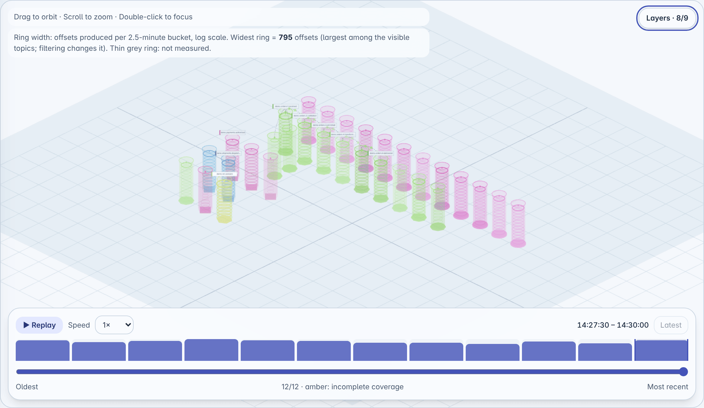

# Kafka Strata 3D — spatial observability

Kafka Strata 3D is an optional, read-only Three.js view at **/strata** (Observe → Strata 3D).
It provides a time-oriented view of topics and deliberate connections, complementary to
[Stream Flow](../src/main/webapp/src/pages/StreamFlow.tsx), [Lineage](../src/main/webapp/src/pages/Lineage.tsx)
and Topic Explorer.

## Deployment and publication

Open **Observe → Strata 3D** from the application, or navigate to
`http://localhost:8080/strata` when running the default local stack.
Strata runs in the browser: there is **no server-side GPU dependency**, dedicated
container, additional port or Strata-specific environment variable. WebGL2 is
needed for the 3D canvas, but the topic navigation and evidence controls remain
usable if the scene is unavailable.

The current source includes Lots D/E (performance diagnostics, guided evidence
stages and manual snapshots), merged via [PR #662](https://github.com/devdownin/Kafkaexplorer/pull/662).
The [GitHub Pages overview](https://devdownin.github.io/Kafkaexplorer/#strata)
describes the source-tree feature, with a **conceptual illustration**, not a
live screenshot. [Docker Hub](https://hub.docker.com/r/compagnonsdudev/kafkaexplorer/tags)
publishes versioned images separately: a documentation merge does not rebuild a
tag or move `latest`. Verify the image digest and release notes before expecting
these features in a deployed image. See the [container operations guide](DOCKERHUB-OPERATIONS.md).

## Visual grammar

| Element | Meaning | Evidence |
|---|---|---|
| Column | Kafka topic | `GET /api/dashboard` |
| Column colour and socle shape | The topic's **family** (the first two segments of its name); the shade darkens along numbered stages. Presentation only, never a measurement | The topic name |
| Twelve rings, bottom to top | Consecutive 2.5-minute offsets-produced buckets in the last 30 minutes | `POST /api/dashboard/activity` |
| Ring radius (logarithmic) | Relative **offset** production, not current record count | Offset differences by timestamp |
| Horizontal translucent plane | Currently selected time bucket, **same bucket** on every topic | Activity response shared time window |
| Amber highlighted ring | **Candidate** deviation from previous four complete buckets | Client-side, conservative heuristic |
| Dashed line | Flink INSERT dependency **declared** by Lineage | `GET /api/lineage` |
| Fine grey dotted line (*Inferred links* layer, off by default) | A link a **naming convention suggests** (stage *n* → *n + 1*, `.in` → `.out`), never declared, never presented as one | The topic names |
| Particles travelling a link | As many as the target produced in the **latest** bucket, on the rings' log scale; none when unmeasured | `POST /api/dashboard/activity` |
| Near-solid line (*Count comparisons* layer) | A pair a `TOPIC_COUNT_DELTA` metric **compares**, left topic upstream: green within its thresholds, neutral with no verdict yet | `GET /api/metrics` |
| Red or orange link | A `TOPIC_COUNT_DELTA` metric over the two topics is **critical** or **warning** | `GET /api/metrics` |
| Topic name above a column | Every name up to 12 topics; past that the selected, compared, focused, hovered and traced topics and the 8 busiest (*All names* layer writes every one) | The topic name |
| Teal path through the columns | Chronological matches for a searched Kafka key, each **at the height of its instant**, so the slope is the latency; faint when outside the window. **Not proven causal transfer** | `POST /api/stream-flow/stream` |
| Coloured satellites | Lag per partition of the **selected consumer group** | `GET /api/topic/{name}/consumers` |
| Partition ribbons in focus | Per-partition offset-production for each 2.5-minute interval; ribbon width follows each partition's **own measured** rate | `GET /api/dashboard/partition-activity?topic=...` |
| Forecast canopy (solid teal / violet / translucent band) | Measured metric history, projected q50, and model q10–q90 for a **single explicitly scoped** topic | `GET /api/forecasts` and `GET /api/forecasts/{seriesId}` |
| Cyan and violet column halos | Topic A and topic B in comparison; highlights, **not a connection** | Shared topic list and selection |
| Neutral rings, unknown readings | Missing/incomplete data, **not zero traffic** | Availability and coverage metadata |

Flink edges are only drawn when explicit source-topic table → read edge → INSERT
job → write edge → sink table → target-topic relationships exist. Arbitrary
topic proximity and matching names do not create a link. Parser warnings are
shown. No link is not evidence of absent activity.

**Arrange.** *Spiral* gives every topic the slot it was first given. *Pipeline lanes* puts one family per
lane, its numbered stages left to right, so a pipeline reads along its length; the choice is part of
the view link (`sv.layout`). The **Families** legend in the navigator names the families present and
filters on one.

## Using the view

1. Open **Observe → Strata 3D**. Use the search box to limit to at most 48
   visible topics. Camera movement uses OrbitControls: drag to orbit, wheel to
   zoom, and pointer dragging to pan; keyboard-only selection is available in
   the adjacent topic navigator and its accessible mini-map controls.
2. Use **Temporal lens** to select an interval. The plane and highlighted ring
   correspond to the same server-provided interval across all topics.
   **Latest** returns to the latest bucket. A new activity snapshot is
   retrieved every 30 seconds while the tab is visible.
3. Select a topic to show retained-offset estimates, time-bucket production
   and consumer groups. Choose a group to inspect per-partition lag. No commit
   is shown as unknown (not as lag 0); negative lag is preserved.
4. Enter a Kafka record key in **Trace a message key** and select **Trace in 3D**.
   The trace is **explicitly initiated**, scans at most 100 recent messages per
   visible topic within the previous 30 minutes, and is cancellable. Intermediate
   evidence may be shown before completion. Use **Full Stream Flow** for
   expanded search scope, path, header matching and continuation of partial
   scans. The 3D arcs connect chronological matches; they are **not** proof of
   causality. A record is identified by topic, partition, offset and timestamp.
5. Inspect **Unusual activity in this time slice**: the selected bucket is only
   flagged if complete and deviates strongly from a measured four-bucket local
   baseline. These are **visual leads**, not health incidents or automatic
   alerts. Comparisons use **offset production**, not Kafka record payloads.

## Immersive cockpit and diagnostic UI — UI/UX P1–P2

The main workspace is arranged as **three coordinated panes** on desktop:

- **Left — Topic navigator:** searchable bounded topic list, evidence completeness dots,
  selected-bucket offset counts and a stable top-down mini-map. Single-click selects;
  double-click focuses. The mini-map uses coordinates anchored to the **whole cluster**,
  so filtering cannot move a topic's point relative to its previous location.
- **Center — Spatial scene:** Three.js view with bounded, hover-triggered readouts,
  a compact layer control and a **timeline dock inside the scene**. The dock shows
  the twelve bucket contributions from topics with full coverage; unknown readings
  do not count toward totals. Amber bars indicate incomplete topic coverage, not a
  confirmed anomaly. Replay remains bounded to the latest sampled 30-minute window
  and stops when an operator manually selects a time bucket.
- **Right — Diagnostic inspector:** Investigate/Compare modes, topic provenance,
  synchronized A/B curves, measured throughput differences, the selected group's
  consumer positions and bounded peer lag measurements. The group comparison only
  considers the **same selected group ID** on both topics; when it is absent from
  the bounded search or any partition has no commit, lag stays **unknown**, never 0.

On large displays, navigator and inspector have pointer-draggable separators
and keyboard-operable resize handles (left/right arrows, 206–430px). Both panes
can be hidden to give the scene additional space. On smaller screens, panels
stack beneath the scene. Forecast, partition evidence and operator-initiated key
tracing remain accessible in the **Evidence details** section.

The **Layers** menu toggles activity rings, declared Flink lineage, count comparisons,
inferred links, key traces, selected consumer-group satellites, anomaly highlights, the
spatial forecast and whether every topic name is written.
These are *presentation-only* switches; they do not change the shared time
window, trigger Kafka message scans or alter stored data. Selection in
Investigate also emphasizes declared neighbors without inventing edges.

### Measurement truth and hover readouts

Hovering a topic shows its selected-bucket offset production, latest measured
offsets/minute, partition coverage, completeness and last sample time. A
measurement can be **measured**, **partial**, **unavailable** or **stale**
(older than 90 seconds). The mini-map and topic list work without WebGL.

The inspector deliberately withholds the 30-minute total and latest rate when
the corresponding measurement cannot be guaranteed complete by
`bucketReading`. Comparisons only display A−B throughput differences when
**both** topic rates are fully covered. Relative percentages are unavailable
when topic B has a zero rate. Consumer-group lag is never presented as a
topic-wide health score; missing commits or unknown group discovery are not
represented by zero.

## UI/UX Lot C — finitions, clavier et accessibilité

- **Navigation au clavier :** `/` ouvre et focalise la recherche de topics, `?` affiche l'aide ;
  `F` focalise le topic sélectionné, `O` restaure la vue globale, `C` ouvre
  la comparaison, espace démarre ou met en pause le replay, et Échap ferme
  l'aide ou revient de la focalisation. Les raccourcis locaux ne se déclenchent
  pas quand un champ, bouton, lien, menu ou dialogue possède le focus.
  **`Ctrl/⌘+K` reste réservé à la palette de commandes globale.**
- **Mini-carte et listes :** cibles de mini-carte agrandies, état de sélection
  accessible via `aria-pressed`, focus visible et `Shift+Entrée` pour focaliser
  depuis la liste ou la carte. Une interaction souris n'est pas requise.
- **Panneaux :** les trois colonnes simultanées sont réservées aux écrans
  suffisamment larges (`2xl`). Sur tablettes et mobiles, la scène précède
  verticalement le navigateur de topics et l'inspecteur. Les commandes restent
  utilisables indépendamment de WebGL. Les séparateurs des panneaux sont
  également redimensionnables avec les flèches gauche et droite.
- **Surfaces :** seuls les outils flottants ont un fond légèrement translucide.
  Les panneaux de lecture demeurent opaques. Les préférences de transparence
  réduite, de contraste renforcé et de couleurs forcées désactivent les
  effets décoratifs incompatibles.
- **Contrats vérifiés :** les fenêtres d'offsets abrégées ou incohérentes
  sont inconnues, même si elles contiennent quelques comptes positifs.
  Les rubans par partition ne s'affichent que si leur fenêtre temporelle
  correspond exactement à celle du curseur de cluster. Le budget
  serveur de lecture inclut `earliest`, `latest` et les frontières.
- **Partage :** les URLs de vue excluent tous les paramètres sans rapport,
  les clés de trace, le contenu des enregistrements **et le fragment URL**.
  Le lien distinct `Full Stream Flow` peut inclure volontairement une clé
  Kafka dans l'URL : ne pas partager ce lien pour une clé sensible.

La revue technique, l'inventaire des corrections et les risques résiduels
figurent dans l'[audit complet du module](notes/strata-3d-audit.md).

## Immersive exploration — P1

- **Focus:** double-click a topic column or a topic in the list, or activate **Focus partitions and forecast** in the inspector. The camera smoothly approaches that topic and reveals its partition ribbons. Use **Return to overview** to restore the whole cluster. Camera easing follows the motion preference; with motion disabled, the transition snaps directly into place.
- **Stable placement:** columns are laid out using each topic's position in the complete, sorted cluster list. Filtering does not reshuffle the remaining topics. Changing which topics are visible re-fits the camera around their world-space bounds.
- **Partition production:** only the focused topic triggers the bounded partition API. Each ribbon's width is proportional to a logarithm of the offsets produced by that **partition**, in that time bucket. An absent reading or a bucket preceding the partition's retention boundary has **no segment**. A missing ribbon does not mean an idle partition. The scope is capped at 24 partitions and the configured global offset-lookup budget; omissions and failed partitions are declared by the endpoint. The partition detail is refreshed while the tab is visible, not collected for all topics.
- **Replay history:** the **Replay** control advances the time lens through the existing measured 12-bucket window. Speeds of 0.5×, 1×, 2× and 4× are available. This replay uses the latest snapshot only and does not read individual Kafka records. A new broker sample may replace the displayed window between steps; this is a live replay, **not a historical persisted recording**.

## Advanced diagnostic workspace — P2

The panel under the spatial scene keeps the **selected topic**, its existing consumer
inspector, focus details, forecast and key-trace evidence in one read-only diagnostic
workspace. The mode toggle changes the analysis, without resetting the time lens.

### Investigate

- **Select a topic** by clicking its column or its name in the accessible list.
  Select **Investigate** to see inbound and outbound dependencies from **explicit Flink
  INSERT paths** in the currently displayed graph. Paths touching the selected topic
  are brighter; other declared paths remain dim. Each dependency identifies its Flink
  job. Nearby geometry alone never creates an edge. The list can be restricted to
  the selected topic's visible neighborhood.
- **Trace a message key** remains an operator-initiated, bounded scan with explicit
  coverage. When a trace is available, the workspace reports the selected topic's
  matched occurrence count and first timestamp. A capped count is labelled a
  *lower bound*; a partial trace does not imply that other topics have no records.
  Key matches establish chronology, **not proven causal transfers**.
- **Lag and anomalies** come from the existing topic inspector and selected group's
  committed offsets, plus conservative anomaly candidates for the selected
  time slice. These are separate evidence categories and are not combined into a
  fabricated health score.

### Compare

- Choose **Compare**, select topic **A** in the topic list or 3D scene, then choose
  a distinct visible topic **B**. Cyan and violet halos distinguish both columns.
  No line between them is invented simply because comparison is active.
- Both curves use **the same `POST /api/dashboard/activity` snapshot**, window,
  bucket boundaries and the one shared time-lens cursor. The readout compares
  produced offsets in the selected bucket and average offsets/minute only when
  all twelve bucket values have complete partition and retention coverage.
  Unknown readings remain gaps; partial totals are not presented as reliable
  throughput. No additional message scan or offset query is triggered by Compare.
- A short-lag correlation uses **Pearson r** for the 12 complete, aligned offset
  delta buckets, testing only 0, ±1 or ±2 bucket shifts (up to ±5 minutes).
  At least eight aligned points, non-constant series and r ≥ 0.65 are required
  before presenting an *exploratory temporal association*. Incomplete coverage,
  mismatched windows or flat series produce no association. A leading offset
  curve does **not** prove message processing order, a transfer, causality,
  statistical significance or an operational incident.
- The panel also shows each topic's measurement coverage and any
  conservative local deviation in the selected slice.

### Limits and accessibility

**Reading the scene.** A legend in the scene's top-left corner states the ring scale: width is
offsets produced per 2.5-minute bucket on a log scale, against the largest bucket among the
*visible* topics — it names that number, and filtering changes it. A column keeps its position
and its colour for the whole session: a topic created or deleted elsewhere moves nothing, and
the camera re-frames only when the filter changes, a visible topic disappears or the camera was
never moved. The forecast canopy carries its top and bottom values with the metric's unit.

**Touch screens.** One finger scrolls the page; two fingers orbit and zoom; a double tap on a
column focuses it. **Escape** steps back one level: it leaves the focused topic, then the
comparison.

**When a refresh fails.** The last activity sample is kept and an alert says the refresh failed;
readings turn *stale* after 90 seconds rather than disappearing. The inspector and the status
bar are not live regions, so a screen reader is not interrupted by each 30-second poll.

**Why a POST.** The activity is requested with the topic list in the body: 48 names of up to 249
characters overflow the 8 KB request line a default Tomcat accepts. `GET /api/dashboard/activity`
remains for short lists.

The workspace uses the existing 48-topic visible limit; correlations apply
only to topics included in that bounded snapshot. Filtering that hides a topic
invalidates its displayed comparison rather than silently reusing stale readings.
The investigation and comparison modes are standard accessible toggle buttons;
the topic list, selects, legends and summaries are usable without WebGL.
Calculations are local and do not add backend write operations.

## Forecast spatial projection — P3 extension

- **Provenance:** the forecast-status endpoint exposes `topics` and `groups` from the **explicitly operator-approved** series configuration, not guessed from a metric title or SQL expression. A series with multiple topics is deliberately not attached to a single topic. This is a read-only extension of `ForecastController.SeriesView`.
- **Eligibility:** only real `TIMESFM` results in `READY` state with a compatible metric output unit, sufficient non-imputed observations and points later than the forecast's history endpoint are rendered. Expired, degraded, missing or ambiguous series display a reason rather than an invented future. A shadow series is labelled **not approved**.
- **Geometry:** the separate teal observed curve and violet predicted-median curve appear next to the focused topic on an **independent metric axis**. The translucent canopy is the q10–q90 range returned by the model. Neither the metric's values nor this band are recast as Kafka offset counts, and q10–q90 is not an empirically guaranteed coverage interval.
- **Inspection:** the companion chart and legend display actual time coordinates, value units, model ID, visibility and forecast horizon. The **Metrics** page remains the source for model quality and the observed-versus-predicted evaluation.
- **Resource cost:** the view fetches forecast status periodically only while mounted for a focused topic; one detailed series is retrieved on demand. Forecasting is never triggered by simply opening Strata 3D.

## Performance and data-integrity guardrails — P0

- **Measured means complete:** a topic ring uses the same `bucketReading`
  validation as Compare and anomaly detection. Incomplete partition coverage,
  unavailable activity and buckets preceding a retention boundary render as
  **neutral unknown**, not as a positive measured ring or a synthetic zero.
  The normalizing scale also excludes unknown buckets.
- **Demand-driven frames:** the renderer schedules a new frame for OrbitControls
  movement, selection, focus transitions, resize, a time-lens change or data
  updates. With motion paused, no perpetual `requestAnimationFrame` loop
  runs. A real positive, fully measured activity series can animate a pulse,
  subject to a bounded frame rate. Hidden tabs do not render.
- **GPU budget:** the **Render quality** selector supports Auto, Detail and
  Economy. Auto reduces device-pixel ratio, ring tessellation and animation
  frequency when 16+ or 32+ topics are visible. Detail permits up to 2×
  device-pixel ratio; Economy caps it at 1× and uses fewer polygon segments.
  The choice does not change Kafka sampling, metrics or projection geometry.
- **Context handling:** when WebGL cannot initialize or the browser loses
  its context, the page displays a text fallback and the topic list remains
  accessible. The renderer, materials, handlers and scene are disposed on
  unmount; context recovery requests a fresh frame.

## Presets and shareable views — P3

- **Overview** resets camera focus and comparison mode while preserving the
  selected topic and shared time cursor. **Focus selected** centers the
  visible topic with partition ribbons and eligible forecast. **Compare**
  enters the synchronized two-topic workspace.
- **Copy view link** includes topic A, topic B, focused topic, filter text,
  diagnostic mode, selected time bucket and render-quality preference. Opening
  the URL restores those choices within the current cluster's visible scope.
  Values are validated and bounded; a topic not present in the cluster does
  not magically appear. Other URL parameters are preserved.
- A shareable link contains **no Kafka message keys, traces, record content,
  forecast payload or credentials**. This is a URL bookmark, not an
  account-synced preset store, and does not persist a broker history snapshot.
  The operator sees newly sampled data after reopening the same view.

### Browser validation

The PR screenshot workflow executes `docs/screenshots/strata-webgl-probe.mjs`
against the **built JAR's SPA** in headless Chromium with software WebGL.
The probe asserts a live WebGL2 context, an actual OrbitControls image change,
URL restoration, partition focus and a return to overview. The fixture server
uses a deterministically bounded per-partition offset distribution aligned to
the topic-activity response. This is a regression gate, not a substitute for
manual visual review across devices and GPU drivers.

## Behaviour under constraints

- Cluster metadata refreshes every 60 seconds and Lineage every 120 seconds.
  Polls stop when the tab is hidden and abort on unmount; overlapping requests
  are avoided. The Three.js context and OrbitControls are preserved when metric
  values update. Changing the set of visible topics deliberately refits the camera.
- Activity retrieval is limited by server budgets as well as the 48-topic view
  limit; partial/missing readings are not interpreted as zeros.
- Consumer group inspection occurs only for the selected topic, refreshed
  every 30 seconds; up to 64 partition satellites are shown in 3D, while the
  inspector displays up to 100 partitions with exact lag numbers.
- The temporal baseline detector requires complete partition and retention
  coverage; only four preceding complete buckets form a baseline.
- A tracing request always requires a user action. Cancelling aborts the
  request and prevents further scanning where supported by the server.
- With WebGL unavailable, the topic list remains accessible. Users who prefer
  reduced motion may leave animation disabled.

## Data boundaries

Kafka does not expose proof that any two topic messages were directly transferred
between topics without trace evidence or an operational lineage source.
The visualization intentionally distinguishes declared Flink paths, observed key
matches, statistical activity and unknown states. It does not create a Kafka
consumer for visual particle animation. Forecast projections require an explicit one-topic mapping, a verified
metric unit and real model quantiles; they remain an independent measure rather
than a continuation of Kafka-produced-offset rings.

## Validation

Frontend: `cd src/main/webapp && npm ci && npm run build && npm run lint && npm test`.

The focused `strataTime.test.ts`, `strataForecast.test.ts`,
`strataImmersive.test.ts`, `strataLineage.test.ts` and `strataDiagnostics.test.ts` tests verify
bucket coverage, conservative anomaly detection, declared-only topic paths,
complete versus partial comparison and non-causal correlation.
Runtime checks should additionally verify orbit, selection, light/dark modes,
WebGL fallback, trace cancel, and missing/partial Kafka metadata.

## Lot D — Rendering diagnostics and accessibility hardening

The collapsed **Scene telemetry (local)** panel displays the most recent browser-side WebGL
sample every three seconds while the tab is visible: active FPS, last-frame draw calls,
allocated Three.js geometry/texture object counts, actual device pixel ratio, topic
count and most recent scene-rebuild duration. An idle scene uses demand rendering and
intentionally reports **on-demand / no FPS** rather than a fabricated 0 FPS. The
counts are *not* GPU memory consumption in bytes. Diagnostics do not call Kafka,
send telemetry to a server or persist measurements.

The render budget, bounded topic and partition counts, renderer disposal and
WebGL loss fallback remain in place. Changes to the operating system's
**Reduce motion** preference also update the active animation mode. Manual
Pause/Resume remains available. All monitoring controls use native HTML
elements outside the canvas so they can be reached with a keyboard.

**Validation checklist before a release:** run the frontend preflight and the
Chromium/WebGL interaction probe; then inspect a real integrated GPU, discrete
GPU and a mobile touch device in both light/dark modes. Check scene
rebuilds, context loss, focus order, contrast, 200% zoom, reduced-motion
transitions and absence of horizontal overflow. Chromium SwiftShader is not
a substitute for physical hardware profiling, and the code is not a formal
WCAG accessibility certification.

## Lot E — Guided investigation, bounded leads and local snapshots

In **Investigate** mode, the inspector offers four ordered evidence stages:
offset production and coverage, declared Flink paths, the selected consumer
group, then explicitly initiated message-key tracing. Each stage can be reached
by a native numbered button or Previous/Next; navigating stages introduces
no new Kafka reads.

**Signals to inspect** appear in a bounded evidence list and as amber/red outlines on the accessible topic mini-map. They are calculated only from the current sampled window:
fully covered local offset deviations and consumer-group lag for the
*currently selected group and topic*. Incomplete, unavailable or stale
activity cannot generate an offset-deviation signal. A selected group with
lag and no assigned members is labelled as a scoped stalled-group observation.
The panel does not compute an overall congestion score, infer a relation
from topic proximity or claim that time correlation proves causation.
Topics with no visible signal may still lack measurements.

**Save investigation snapshot** downloads an allowlisted JSON document in
the browser with a schema version, capture time, selected topic and time
bucket, coverage and measured offsets, current view choices, declared
lineage and the currently selected group's status. It excludes raw Kafka
message keys, values, headers, full trace matches, credentials and arbitrary
server responses. No snapshot is automatically stored or uploaded. The
download is intentionally **not a live data source**: it reflects the last
received samples and records their sampling time. Only share it when topic,
Flink-job and group names are suitable for the recipient.

The JavaScript unit tests exercise missing/stale observations, scoped
consumer lag, the non-causal signal vocabulary and the snapshot allowlist.
The WebGL browser probe also exercises the telemetry disclosure, stage
navigation and snapshot download.

