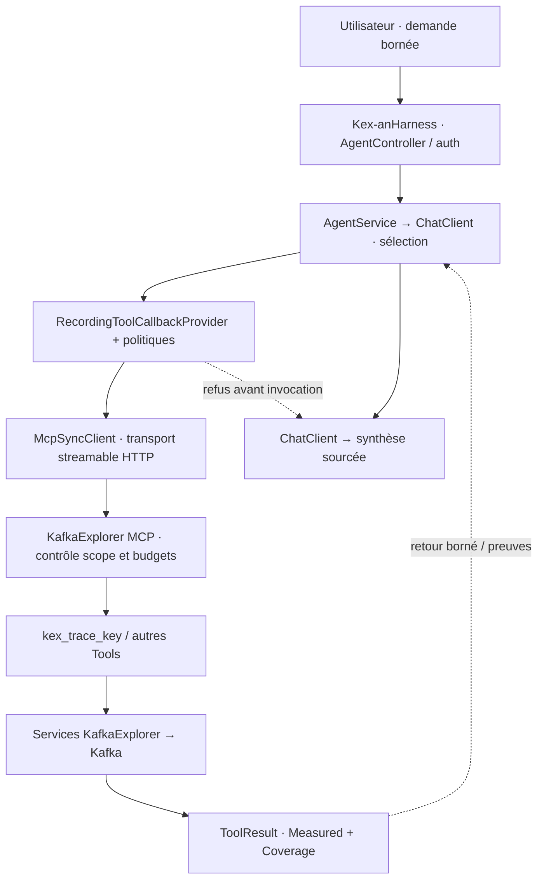

# Guide pédagogique · Skills et services via MCP

> **Objectif.** Choisir la bonne primitive (Skill, Tool, Resource ou Prompt), orchestrer
> des appels vérifiables, et comprendre le trajet d’une requête entre
> [Kex-anHarness](https://github.com/devdownin/Kex-anHarness) et KafkaExplorer.

**Parcours interactif dans l’application :** ouvrez **MCP → MCP Guide**, route
`/mcp/guide`. La visualisation permet de sélectionner les scénarios « Incident »,
« Forecast » et « Skill », puis d’inspecter chaque composant et ses garanties.

Cette page est indépendante de l’activation du serveur MCP : on peut apprendre
le protocole sans ouvrir un accès au cluster.

### Explorer et partager un parcours

Dans l’application comme sur le site public, le graphe propose les filtres de rôles
**Utilisateur, Agent, Gouvernance, Transport, Services, Preuves**. Les nœuds non
sélectionnés sont atténués, **jamais retirés**, pour préserver les intermédiaires
de la chaîne d’appel. Le graphe accepte les flèches et les touches Début/Fin.
Le zoom est proposé sur grand écran ; sur mobile, une liste verticale conserve
les neuf étapes et leur détail sans imposer un panoramique horizontal.

Les paramètres `?scenario=incident|forecast|skill&step=<identifiant>&focus=<rôle>`
permettent de partager une vue précise. Par exemple :

`/mcp/guide?scenario=forecast&step=evidence&focus=evidence`

L’option **Copier Mermaid** exporte la version textuelle du scénario affiché
avec les flèches d’appel et de retour. Ce code décrit toujours une architecture
de référence : **aucune télémétrie d’exécution n’est fabriquée**.

La page GitHub Pages charge son script local `mcp-guide.js` sans service
externe ; le pré-contrôle PR valide la syntaxe JavaScript avec `node --check`.

## 1. Quel concept employer ?

| Primitive | Responsabilité | Exemple KafkaExplorer | Quand |
| --- | --- | --- | --- |
| **Skill** | Décrit une procédure complète avec préconditions, étapes, garde-fous et acceptation | `kafka-incident-triage` | Enquête multi-étapes, analyse de données, release |
| **Tool** | Exécute une action ou une mesure délimitée, sous les droits du serveur | `kex_trace_key`, `kex_consumer_lag` | Lire un état réel ou produire un calcul borné |
| **Resource** | Fournit un contexte adressable et consultable sans lancer une action | `kex://contract`, `kex://skills` | Inventaire, métadonnées, instruction versionnée |
| **Prompt** | Guide la manière de questionner ou de restituer | `kex_incident_triage` | Démarrer un diagnostic structuré |

**Le serveur MCP** est le protocole et l’interface qui expose Tools, Resources et Prompts.
Il ne remplace ni le service métier ni la politique d’autorisation. Un Skill peut appeler
plusieurs Tools, mais il **n’accorde jamais de droits supplémentaires**.

## 2. Graphe d’appel de référence : Kex-anHarness → KafkaExplorer

Reconstruction pédagogique à partir de la
[séquence publiée par Kex-anHarness](https://github.com/devdownin/Kex-anHarness/blob/main/docs/ARCHITECTURE.md),
des [règles d’invocation](https://github.com/devdownin/Kex-anHarness/blob/main/docs/TOOL-CONTROLS.md)
et des [adaptateurs MCP KafkaExplorer](notes/mcp-server.md).

Les deux couches de politique s’additionnent : Kex-anHarness filtre les outils
qu’il présente au modèle et les arguments transmis ; KafkaExplorer applique
ensuite son propre contrôle de périmètre, sa lecture seule, ses plafonds et
le masquage de données. Le premier filtre n’annule pas le second.

**Cette figure est un graphe d’architecture, pas une trace de production.**
Aucune latence, aucun nombre d’appels et aucun résultat Kafka ne sont supposés.
Pour attribuer un événement à un appel réel, utiliser les identifiants de
corrélation, les logs ou traces OpenTelemetry et les résultats `ToolResult`
enregistrés.

## 3. Trois parcours représentatifs

### A. Incident et corrélation

1. Préciser la clé, les topics autorisés et la fenêtre.
2. Lister les outils exposés au client : les extensions et Tools sont opt-in.
3. Utiliser `kex_trace_key` puis, si nécessaire, `kex_resume_trace`.
   Vérifier `kex_consumer_lag`, `kex_dlq_diagnosis` et
   `kex_incident_evidence` selon les symptômes et les outils disponibles.
4. Expliquer `coverage.stopReason`, `topicsNotReached`, les budgets et les valeurs
   non mesurées. Ne pas dire « aucun message » après un scan partiel.
5. Vérifier une amélioration par une nouvelle mesure comparable ;
   ne pas rejouer ou supprimer des messages sans accord explicite.

### B. Forecast de métrique

1. Vérifier les séries autorisées avec `kex_list_forecastable_metrics`.
2. Lire `kex_metric_history`, `kex_forecast_metric` et
   `kex_get_forecast_quality` *si ces outils sont enregistrés*.
3. Distinguer l’historique observé de la courbe prévue, les quantiles
   nominaux de la qualité réellement mesurée, et les résultats obsolètes
   de résultats exploitables.
4. Énoncer l’horizon, la fraîcheur, les limites et une prochaine
   action de lecture. Ne pas activer d’alerte implicitement.

### C. Découverte d’un Skill

1. Côté KafkaExplorer, lire la ressource `kex://skills` pour obtenir les URI
   `skill://{name}/SKILL.md` et les empreintes SHA-256.
2. Lire une ressource `skill://…/SKILL.md` *par son nom publié*, puis vérifier
   l’empreinte sur les octets reçus.
3. L’hôte/agent choisit ensuite s’il peut charger la procédure selon ses
   propres règles ; **lire ne signifie pas installer ou activer**.
4. Kex-anHarness possède aussi ses propres compétences approuvées,
   indexées et accessibles par `read_skill`. C’est **un système distinct** :
   n’affirmez pas que Kex importe automatiquement les SKILL.md distants.
   Voir [skills approuvés chez Kex](https://github.com/devdownin/Kex-anHarness/blob/main/docs/GOVERNED-GENERAL-AGENT.md).

La distribution via Resources ne signifie pas encore support natif de
`skills/list` / `skills/get` ; voir [le contrat actuel](mcp-skills.md).

## 4. Bonnes pratiques et anti-patterns

| Faire | Éviter |
| --- | --- |
| Déclarer le périmètre et la preuve attendue dans le Skill | Transformer le Skill en super-permission |
| Utiliser un Tool pour obtenir une mesure actuelle | Inventer une mesure depuis une réponse générée |
| Lire une Resource de contexte versionné | Faire d’une Resource une API d’action cachée |
| Utiliser un Prompt pour structurer la demande | Cacher des règles critiques dans un prompt |
| Garder les contrôles Kex **et** ceux de KafkaExplorer | Contourner un refus ou élargir le scope |
| Signaler toute lecture partielle ou valeur inconnue | Convertir `UNKNOWN` en `0` |
| Reprendre une mesure pour vérifier la résolution | Confondre « appel accepté » et « objectif atteint » |

### Checklist d’intégration

- Le serveur est-il initialisé et sa connexion est-elle explicitement autorisée ?
- La liste des Tools et Resources réellement exposés a-t-elle été découverte ?
- Le Skill est-il relu, versionné, approuvé et adapté à cette tâche ?
- Les arguments, budgets, topics et groupes restent-ils dans leur scope ?
- Les preuves livrent-elles `measured`, `reason` et `coverage` ?
- Les mutations demandent-elles une approbation et une vérification distinctes ?

## 5. Prolonger l’apprentissage

- [Page MCP et Skills de KafkaExplorer](mcp-skills.md)
- [Spécification MCP KafkaExplorer](../SPEC-MCP.md)
- [Architecture de Kex-anHarness](https://github.com/devdownin/Kex-anHarness/blob/main/docs/ARCHITECTURE.md)
- [Contrôles d’outils de Kex-anHarness](https://github.com/devdownin/Kex-anHarness/blob/main/docs/TOOL-CONTROLS.md)
- [Compétences revues de Kex-anHarness](https://github.com/devdownin/Kex-anHarness/blob/main/docs/GOVERNED-GENERAL-AGENT.md)
- [Évaluations d’agent de Kex-anHarness](https://github.com/devdownin/Kex-anHarness/blob/main/docs/AGENT-EVALUATIONS.md)

> **Sécurité.** Cette documentation décrit des parcours. Elle n’exécute aucune
> mesure Kafka, n’ouvre pas les connexions MCP et ne contient pas de token.
